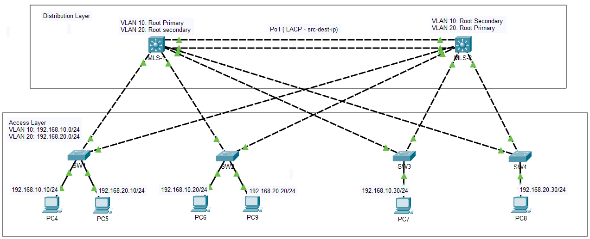
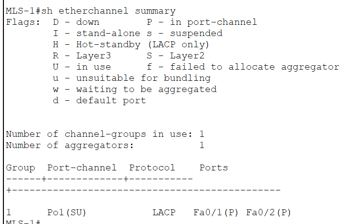
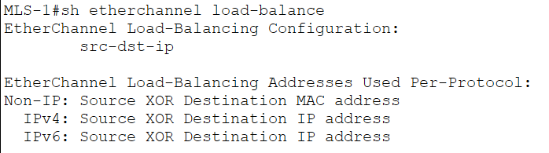

A - Overview
- Tên Lab: Xây dựng mô hình mạng hai lớp: Access Layer - Distribution Layer
- Mục tiêu: Loại bỏ lặp, làm nền tảng dự phòng tối ưu và cân bằng tải

B - Sơ đồ & Quy hoạch IP 
- Link sơ đồ:  
- Bảng quy hoạch IP:

C - Các công nghệ & Quyết định thiết kế 

1. Spanning Tree Protocol: Triển khai Rapid-PVST+ kết hợp cân bằng tải VLAN 
2. EtherChannel & Hash Algorithm: Gồm trunk giữa 2 MLS bằng LACP (mode active) & phân tải lưu lượng src-dest-ip đa dạng luồng
3. Access Layer Hardening: Kích hoạt Portfast tránh thời gian chờ, BuardGuard tránh có SW lạ cắm vào 
4. Uplink Strategy: Lựa chọn mô hình 2 dây(Mỗi dây 1 MLS) nhằm tối ưu tài nguyên và 4 dây đối với enterprise lớn (Stacking)

D - Kiểm thử và xác thực 
1. show spanning-tree vlan 10

2. show ethernet summary
   

3. show ethernet load-balance

E. Hướng đẫn chạy thử 
1. Cisco Packet Tracer 9.0 Window
2. Tải file .pkt trong /lab và chạy 
