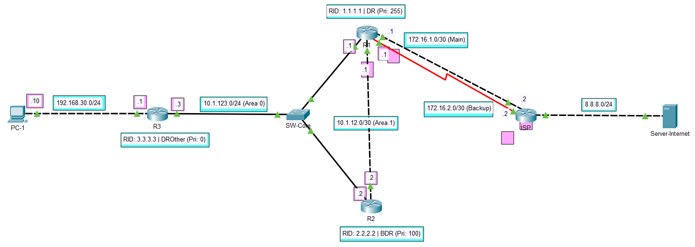
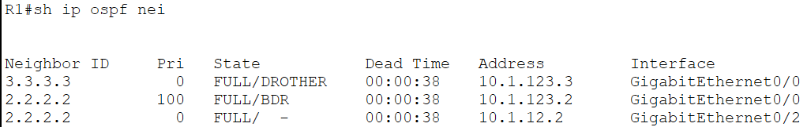
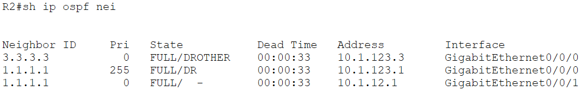
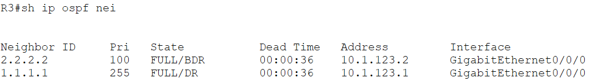

# Enterprise Routing OSPF

## 1. Network Topology & System Architecture

Mô hình lab tích hợp 4 Router Cisco (R1, R2, R3, ISP), 1 Switch Layer 2 (SW-CORE), 1 PC (PC1) và 1 Server Internet:

### Phân vùng Area & Vai trò thiết bị:
* **Area 0 (Backbone Area):** Bao gồm phân đoạn Multi-access Ethernet `10.1.123.0/24` qua switch SW-CORE và mạng LAN người dùng `192.168.30.0/24`
* **Area 1:** Liên kết điểm-điểm (Point-to-Point) `10.1.12.0/30` giữa R1 và R2, định vị **R1** và **R2** làm các **ABR (Area Border Router)**
* **ASBR Gateway:** **R1** đóng vai trò ASBR kết nối trực tiếp với ISP qua 2 đường truyền (Ethernet chính và Serial dự phòng), bơm tuyến mặc định ngoại lai (`O*E2`) vào toàn miền OSPF

---

## 2. Core Architectural Implementations

### 2.1. Tối ưu hóa hội tụ OSPF & Bầu chọn DR/BDR
* **Triệt tiêu 40s Wait Timer:** Trên link nối riêng R1-R2 (`Gi0/1`), ép kiểu `ip ospf network point-to-point`. Kiểu mạng này loại bỏ việc bầu chọn DR/BDR, thiết lập quan hệ láng giềng `FULL/-` ngay lập tức khi bắt tay
* **Chỉ định DR/BDR tất định:** Phân đoạn Multi-access Ethernet `10.1.123.0/24` được cấu hình OSPF Priority:
  * R1: `ip ospf priority 255` (Ép làm DR)
  * R2: `ip ospf priority 100` (Ép làm BDR)
  * R3: `ip ospf priority 0` (DROther cố định, không bao giờ tham gia bầu chọn)
* **Bảo vệ mạng LAN với Passive-Interface:** Cổng `Gi0/1` trên R3 được cấu hình `passive-interface` nhằm triệt tiêu việc phát gói OSPF Hello rác xuống máy PC, bảo vệ CPU của trạm người dùng và ngăn ngừa nguy cơ kết nối giả mạo láng giềng định tuyến

### 2.2. Tuyến mặc định ngoại lai `O*E2`
* R1 thực thi lệnh `default-information originate` để đẩy Default Route tĩnh ra ISP vào OSPF
* Tuyến đường xuất hiện trên R2 và R3 dưới dạng `O*E2 0.0.0.0/0 [110/1]`:
  * **`O*`**: Candidate Default Route học qua OSPF
  * **`E2` (External Type 2):** Tuyến ngoại lai nạp từ bên ngoài vào. Toàn bộ router trong vùng OSPF giữ nguyên giá trị chi phí Metric cố định (`Metric = 1`), không cộng dồn chi phí đường truyền nội bộ qua các chặng

---

## 3. Verification & Evidences

### 3.1. Trạng thái OSPF Neighbors (DR / BDR / DROther)
Xác nhận thiết lập quan hệ láng giềng và phân định vai trò chuẩn xác:
* **R1 (DR):** Quan hệ FULL với R2 (BDR) và R3 (DROther)
  
* **R2 (BDR):** Quan hệ FULL với R1 (DR) và R3 (DROther)
  
* **R3 (DROther):** Xác nhận vai trò DROther, láng giềng FULL/DR với R1 và FULL/BDR với R2
  

---
