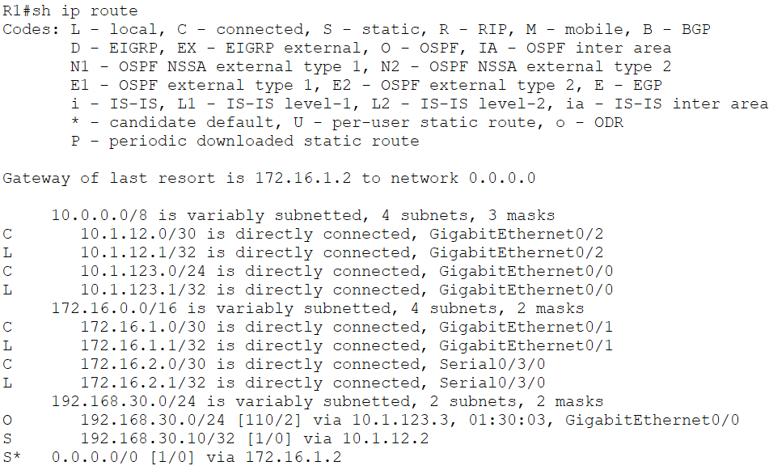
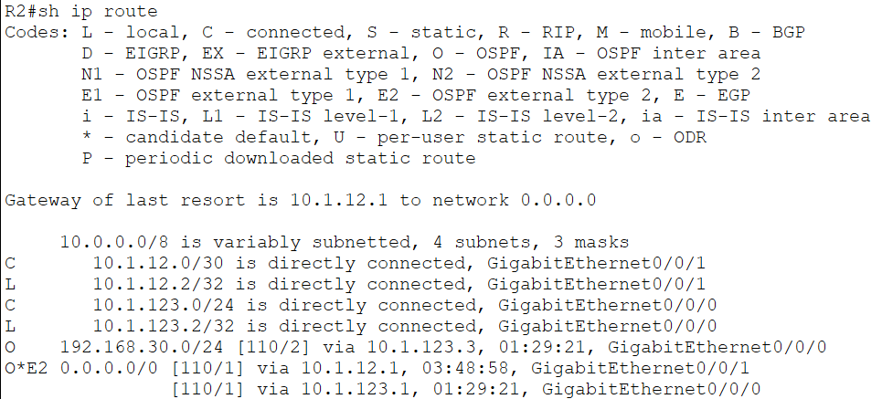
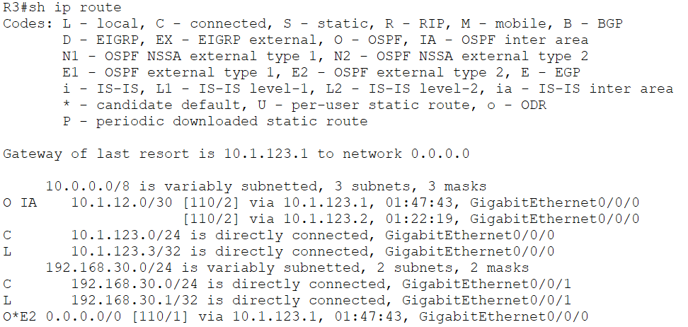

# Enterprise Multi-Area OSPF & Packet-Flow Lifecycle Lab

Repository này ghi lại chi tiết quá trình thiết kế, triển khai và kiểm thử hệ thống mạng doanh nghiệp tích hợp định tuyến **OSPF Multi-Area**, tối ưu hóa kiểu mạng (Network Type), phân tích vòng đời đóng gói Layer 2/Layer 3, và cấu hình dự phòng Floating Static Route ra ISP.

---

## 1. Network Topology & System Architecture

Mô hình lab tích hợp 4 Router Cisco (R1, R2, R3, ISP), 1 Switch Layer 2 (SW-CORE), 1 PC (PC1) và 1 Server Internet:


### Phân vùng Area & Vai trò thiết bị:
* **Area 0 (Backbone Area):** Bao gồm phân đoạn Multi-access Ethernet `10.1.123.0/24` qua switch SW-CORE và mạng LAN người dùng `192.168.30.0/24`.
* **Area 1:** Liên kết điểm-điểm (Point-to-Point) `10.1.12.0/30` giữa R1 và R2, định vị **R1** và **R2** làm các **ABR (Area Border Router)**.
* **ASBR Gateway:** **R1** đóng vai trò ASBR kết nối trực tiếp với ISP qua 2 đường truyền (Ethernet chính và Serial dự phòng), bơm tuyến mặc định ngoại lai (`O*E2`) vào toàn miền OSPF.

---

## 2. IP Addressing & Interface Plan

| Device | Interface | IP Address | Subnet Mask | Area / Type | Vai trò chức năng |
| :--- | :--- | :--- | :--- | :--- | :--- |
| **R1** | Loopback0 | 1.1.1.1 | 255.255.255.255 | Area 0 | Router-ID / Management Host Route (/32) |
| | Gi0/0 | 10.1.123.1 | 255.255.255.0 | Area 0 | Multi-access LAN (OSPF Priority 255 $\to$ DR) |
| | Gi0/1 | 10.1.12.1 | 255.255.255.252 | Area 1 | Inter-router P2P (`ip ospf network point-to-point`) |
| | Gi0/2 | 172.16.1.1 | 255.255.255.252 | External | WAN chính nối ISP (Default Route, AD = 1) |
| | Se0/0/0 | 172.16.2.1 | 255.255.255.252 | External | WAN dự phòng nối ISP (Floating Static Route, AD = 120) |
| **R2** | Loopback0 | 2.2.2.2 | 255.255.255.255 | Area 0 | Router-ID / Management Host Route (/32) |
| | Gi0/0 | 10.1.123.2 | 255.255.255.0 | Area 0 | Multi-access LAN (OSPF Priority 100 $\to$ BDR) |
| | Gi0/1 | 10.1.12.2 | 255.255.255.252 | Area 1 | Inter-router P2P (`ip ospf network point-to-point`) |
| **R3** | Loopback0 | 3.3.3.3 | 255.255.255.255 | Area 0 | Router-ID / Management Host Route (/32) |
| | Gi0/0 | 10.1.123.3 | 255.255.255.0 | Area 0 | Multi-access LAN (OSPF Priority 0 $\to$ DROther vĩnh viễn) |
| | Gi0/1 | 192.168.30.1 | 255.255.255.0 | Area 0 | Gateway LAN PC1 (`passive-interface`) |
| **ISP** | Gi0/0 | 172.16.1.2 | 255.255.255.252 | External | Cổng Ethernet chính nối R1 |
| | Se0/0/0 | 172.16.2.2 | 255.255.255.252 | External | Cổng Serial dự phòng nối R1 (Clock rate 64000) |
| | Gi0/1 | 8.8.8.1 | 255.255.255.0 | External | Gateway vùng Server Internet |
| **PC1** | NIC | 192.168.30.10 | 255.255.255.0 | End-device | Default Gateway: `192.168.30.1` |
| **Server** | NIC | 8.8.8.8 | 255.255.255.0 | End-device | Default Gateway: `8.8.8.1` |

---

## 3. Core Architectural Implementations

### 3.1. Phân biệt Connected (`C`) và Local (`L`) trong bảng định tuyến
* **Connected Route (`C`):** Đại diện cho toàn bộ dải mạng con nối trực tiếp ở cổng (ví dụ `10.1.123.0/24`). Được sử dụng để chuyển tiếp (forward) các gói tin đi xuyên qua router tới các trạm làm việc trong subnet.
* **Local Route (`L /32`):** Đại diện cho chính xác địa chỉ IP gán trên chân cổng vật lý của chính Router đó. Dòng này giúp phần cứng CEF nhận diện lưu lượng gửi đích danh cho Router (Ping, SSH, OSPF Hello) để kéo thẳng lên CPU xử lý thay vì chuyển tiếp ra ngoài.

### 3.2. Tối ưu hóa hội tụ OSPF & Bầu chọn DR/BDR
* **Triệt tiêu 40s Wait Timer:** Trên link nối riêng R1-R2 (`Gi0/1`), ép kiểu `ip ospf network point-to-point`. Kiểu mạng này bỏ qua giai đoạn bầu chọn DR/BDR, thiết lập quan hệ láng giềng `FULL/-` ngay lập tức khi bắt tay.
* **Chỉ định DR/BDR tất định:** Phân đoạn Multi-access Ethernet `10.1.123.0/24` được cấu hình OSPF Priority:
  * R1: `ip ospf priority 255` (Ép làm DR).
  * R2: `ip ospf priority 100` (Ép làm BDR).
  * R3: `ip ospf priority 0` (DROther cố định, không bao giờ tham gia bầu chọn).
* **Bảo vệ mạng LAN với Passive-Interface:** Cổng `Gi0/1` trên R3 được cấu hình `passive-interface` nhằm triệt tiêu việc phát gói OSPF Hello rác xuống máy PC, bảo vệ CPU của trạm người dùng và ngăn ngừa nguy cơ giả mạo thiết bị định tuyến láng giềng.

### 3.3. Bản chất tuyến ngoại lai `O*E2`
* R1 thực thi lệnh `default-information originate` để đẩy Default Route tĩnh ra ISP vào OSPF.
* Tuyến đường xuất hiện trên R2 và R3 dưới dạng `O*E2 0.0.0.0/0 [110/1]`:
  * **`O*`**: Candidate Default Route học qua OSPF.
  * **`E2` (External Type 2):** Tuyến ngoại lai nạp từ bên ngoài vào. Toàn bộ router trong vùng OSPF giữ nguyên giá trị chi phí Metric cố định (`Metric = 1`), không cộng dồn chi phí dây dẫn nội bộ qua các chặng.

---

## 4. Verification & Evidences

### 4.1. Trạng thái OSPF Neighbors (DR / BDR / DROther)
Xác nhận thiết lập quan hệ láng giềng và phân định vai trò chuẩn xác:
* **R1 (DR):** Quan hệ FULL với R2 (BDR) và R3 (DROther).
  
* **R2 (BDR):** Quan hệ FULL với R1 (DR) và R3 (DROther).
  
* **R3 (DROther):** Xác nhận vai trò DROther, láng giềng FULL/DR với R1 và FULL/BDR với R2.
  

---

### 4.2. Bảng định tuyến RIB (Routing Information Base)
Kiểm tra bảng định tuyến thực tế trên các thiết bị:
* **Bảng định tuyến R1:** Xuất hiện đồng thời route tĩnh ra ISP, các route Connected `C`, Local `L`, và OSPF Inter-Area (`O IA`).
  
* **Bảng định tuyến R2:** Nhận tuyến Default Route ngoại lai `O*E2` trỏ về Next-hop R1 qua cổng Gi0/0.
  
* **Bảng định tuyến R3:** Xuất hiện tuyến ngoại lai `O*E2` đẩy từ R1 và dải LAN Connected nội bộ.
  

---

## 5. Troubleshooting & Asymmetric Routing Runbook

### 5.1. Bắt bệnh lệch tuyến hai chiều (Two-Way Routing Missing)
* **Triệu chứng:** Khi chạy `tracert 8.8.8.2` từ PC1, gói tin qua được hop 1 (`192.168.30.1`) và hop 2 (`10.1.12.1` - R1), nhưng từ hop 3 trở đi hoàn toàn bị timeout (`* * *`).
* **Phân tích:** 
  * Chiều đi từ PC1 đến R1 và từ R1 đến Server Internet thông suốt (R1 tự ping `8.8.8.2` thành công vì dùng Source IP `172.16.1.1` nối trực tiếp với ISP).
  * Khi gói tin xuất phát từ PC1, Source IP là `192.168.30.10`. Router ISP nhận được gói tin nhưng bảng định tuyến không có route về dải `192.168.30.0/24` $\to$ ISP drop gói tin phản hồi ở chiều về.
* **Khoanh vùng lỗi bằng Extended Ping trên R1:**
  ```text
  R1# ping 8.8.8.2 source 192.168.30.1
  ..... (Timeout 100% -> Chứng minh ISP thiếu route chiều về)
