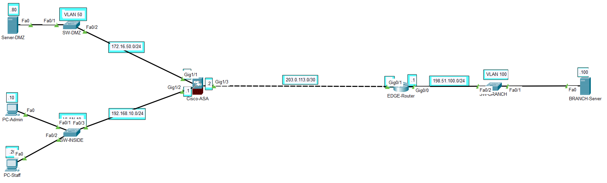

# Enterprise Access Control Lab: ASA Inbound Policies & Router Placement Rules

## 1. Overview
Dự án tập trung triển khai và kiểm chứng các quy tắc kiểm soát truy cập (Access Control Lists - ACLs) trong kiến trúc mạng phân vùng:
- **Extended ACL trên Firewall (Cisco ASA):** Kiểm soát lưu lượng chiều vào (Inbound) từ mạng bên ngoài tới máy chủ Web DMZ trực tiếp theo địa chỉ IP và cổng dịch vụ
- **Standard ACL trên Router biên (Cisco IOS):** Áp dụng nguyên tắc vị trí (Placement Rule) cho bộ lọc Standard ACL, chặn một trạm làm việc cụ thể truy cập máy chủ chi nhánh mà không gây ảnh hưởng tới các luồng dữ liệu khác
- **Hạ tầng Layer 2 & L3:** Phân tách Broadcast Domain qua VLAN độc lập và thiết lập các tuyến định tuyến tĩnh kết nối hai chiều

---

## 2. Network Topology

---

## 3. Configuration Breakdown

### A. Layer 2 Isolation (Access Switches)
- Phân lập lưu lượng thành 3 Broadcast Domain độc lập:
  - `SW-INSIDE`: Toàn bộ cổng hoạt động đặt trong `VLAN 10`
  - `SW-DMZ`: Toàn bộ cổng hoạt động đặt trong `VLAN 50`
  - `SW-BRANCH`: Toàn bộ cổng hoạt động đặt trong `VLAN 100`
- Đưa toàn bộ cổng không dùng vào VLAN 99
