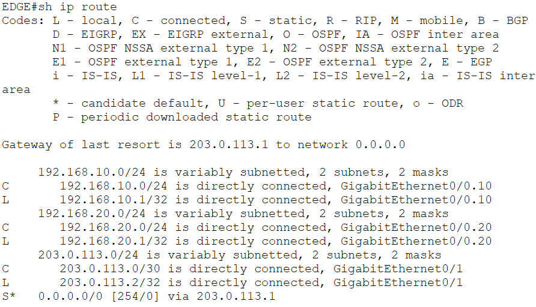
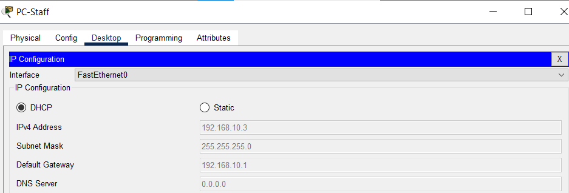
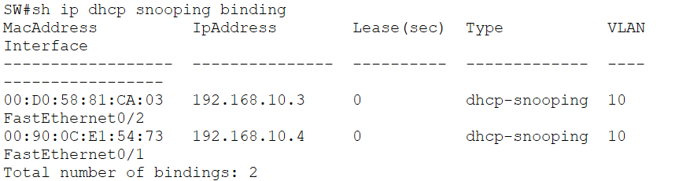
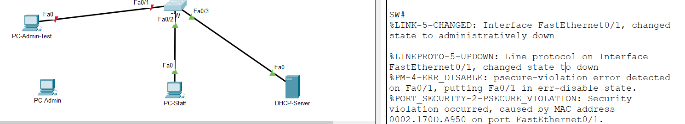

## 1. Overview
Triển khai mô hình bảo mật hạ tầng truy cập mạng doanh nghiệp (Layer 2 Access Layer) kết hợp dịch vụ cấp phát địa chỉ động IP đa Subnet trên nền tảng Cisco IOS:
* **Edge DHCP Client & Dynamic Routing:** Tiếp nhận IP từ ISP qua DHCP, tự sinh Default Route với `AD = 254`
* **DHCP Relay Agent:** Điều hướng gói tin DHCP Discover qua Layer 3 sang DHCP Server nội bộ qua trường `giaddr`
* **DHCP Snooping & Option 82 Mitigation:** Thiết lập ranh giới Trusted/Untrusted Ports, xử lý triệt để lỗi hủy gói tin trên Switch Layer 2
* **Switch Port Security:** Kiểm soát truy cập cổng bằng Static MAC (`shutdown`) và Sticky MAC (`restrict`)

---

## 2. Network Topology & Device Configurations

Chi tiết file cấu hình thiết bị:
* **ISP Router:** [`configs/ISP.txt`](configs/ISP.txt)[cite: 2]
* **Edge Router (DHCP Relay Agent & DHCP Client):** [`configs/EDGE-DHCP-Relay.txt`](configs/EDGE-DHCP-Relay.txt)[cite: 2]
* **Access Switch (Port Security & DHCP Snooping):** [`configs/SW.txt`](configs/SW.txt)[cite: 2]

---

## 3. Key Technical Implementations

### A. WAN DHCP Client & Default Route (AD = 254)
* Cổng WAN của Edge Router được cấu hình nhận IP tự động từ ISP bằng `ip address dhcp`
* Router tự động cài đặt tuyến đường `0.0.0.0/0` trỏ về Gateway của ISP với chỉ số Administrative Distance mặc định `AD = 254` nhằm đảm bảo tính dự phòng

### B. DHCP Relay Agent Operations
* Sub-interface VLAN người dùng tiếp nhận gói `DHCP Discover` dạng Broadcast (`255.255.255.255`)
* Sử dụng `ip helper-address` chuyển đổi thành gói tin Unicast gửi đích danh tới DHCP Server nội bộ, đồng thời điền IP Gateway của Subnet tương ứng vào trường `giaddr` để Server cấp đúng dải IP

### C. DHCP Snooping & Option 82 Fix
* Bật `ip dhcp snooping` trên các VLAN hoạt động; chỉ định Trusted Port về phía Router/Server và Untrusted Ports về phía máy trạm
* Tắt tính năng tự động chèn Option 82 (`no ip dhcp snooping information option`) trên Switch Layer 2 để tránh bị Router/Server hủy gói tin do lỗi `giaddr = 0.0.0.0`

### D. Layer 2 Port Security Hardening
* **Server Port (Fa0/1):** Cấu hình Static MAC cố định, kích hoạt chế độ vi phạm `violation shutdown` (đưa cổng về trạng thái `err-disabled` khi cắm thiết bị lạ)
* **Staff Port (Fa0/2):** Cấu hình Sticky MAC tự động học và lưu vào `running-config`, kích hoạt chế độ vi phạm `violation restrict` (drop lưu lượng lạ, tăng bộ đếm và đẩy Syslog)

---

## 4. Verification & Evidences

### A. Định tuyến & Phân bổ IP
* **Default Route học từ DHCP (AD = 254):**
  [cite: 1]

* **PC-Staff nhận đúng Subnet qua Relay Agent:**
  [cite: 1]

---

### B. DHCP Snooping Binding Database
* **Bảng ánh xạ MAC - IP - VLAN - Interface:**
  [cite: 1]

---

### C. Port Security Enforcement & Violation Testing
* **Trạng thái cấu hình Port Security trên Switch:**
  [cite: 1]

* **Kiểm thử vi phạm mức Restrict (Cảnh báo Syslog, tăng biến đếm):**
  [cite: 1]

* **Kiểm thử vi phạm mức Shutdown (Cổng rơi vào Err-disabled):**
  [cite: 1]
