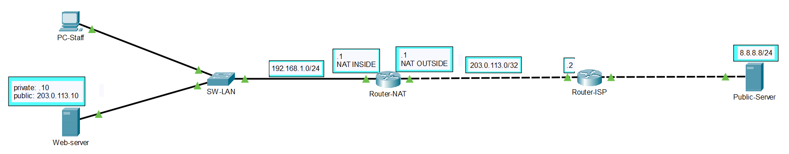
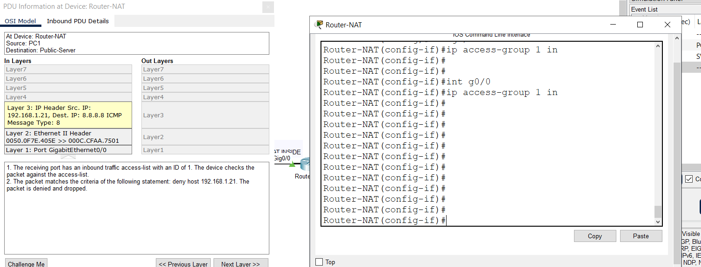
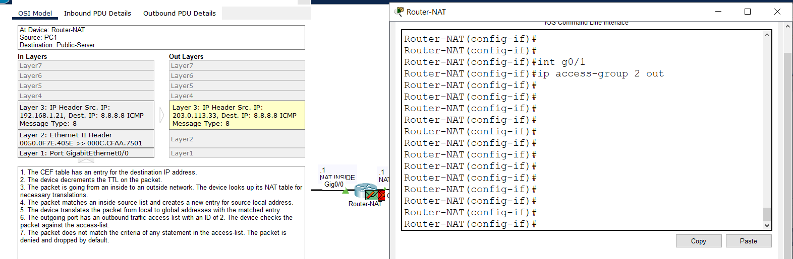

## 1. Overview
Triển khai giải pháp biên dịch địa chỉ mạng (Network Address Translation - NAT): 
* **Static NAT:** Ánh xạ 1-1 cố định cho phép máy chủ nội bộ công khai dịch vụ ra môi trường Internet
* **Dynamic NAT & PAT (NAT Overload):** Tối ưu hóa không gian địa chỉ IPv4, cấp phát linh hoạt cho các nhóm máy trạm qua NAT Pool và quá tải cổng trên giao diện Outside
* **Router Order of Operations:** Kiểm chứng thứ tự xử lý gói tin giữa bảng NAT và Access Control List (ACL) theo cả hai chiều Inside-to-Outside và Outside-to-Inside

---

## 2. Network Topology & Device Configurations

Chi tiết file cấu hình thiết bị và bài lab:
* **Edge Router (NAT):** [`configs/Router-NAT.txt`](configs/Router-NAT.txt)
* **ISP Router:** [`configs/Router-ISP.txt`](configs/Router-ISP.txt)
* **Packet Tracer Lab File:** [`lab/06-nat.pkt`](lab/06-nat.pkt)

---

## 3. Key Technical Implementations

### A. Interface Role Definition
* Chỉ định vai trò cổng Inside nối mạng nội bộ (`ip nat inside`) và cổng Outside nối về ISP (`ip nat outside`)

### B. NAT Implementations
* **Static NAT:** Thiết lập ánh xạ tĩnh giữa địa chỉ Inside Local của Server và địa chỉ Inside Global hợp lệ trên Internet
* **Dynamic NAT & PAT:** Kết hợp Standard ACL với NAT Pool để cấp dải IP động cho máy trạm VIP, đồng thời sử dụng từ khóa `overload` cho phép toàn bộ dải mạng LAN dùng chung IP cổng WAN

### C. Router Order of Operations Validation
* **Inside ->  Outside:** Kiểm chứng nguyên tắc Router thực thi kiểm tra ACL trước khi đưa gói tin vào tiến trình NAT
* **Outside -> Inside:** Kiểm chứng nguyên tắc Router thực thi biên dịch NAT trước khi đối soát điều kiện trên ACL

---

## 4. Verification & Evidences

### A. NAT Translations & Statistics
* **Bảng ánh xạ NAT Translations:**
  

* **Bộ đếm thống kê lưu lượng NAT Statistics:**
  

---

### B. Router Order of Operations Verification
* **Gói tin chiều Inside-to-Outside (ACL trước, NAT sau):**
  

* **Gói tin chiều Outside-to-Inside (NAT trước, ACL sau):**
  
