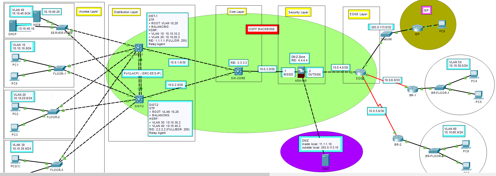

# DỰ ÁN MÔ PHỎNG HỆ THỐNG MẠNG DOANH NGHIỆP

## 1. Tổng quan dự án

Dự án tập trung vào việc thiết kế, cấu hình và triển khai mô hình mạng doanh nghiệp dựa trên kiến trúc mạng 3 lớp

Mô hình mô phỏng môi trường mạng doanh nghiệp với nhiều VLAN, hệ thống chuyển mạch Layer 2 và Layer 3, định tuyến động, các dịch vụ mạng, cơ chế dự phòng và những chính sách bảo mật

**Mục tiêu dự án:**
- Hiểu và triển khai kiến trúc mạng doanh nghiệp
- Phân chia mạng bằng VLAN nhằm quản lý và kiểm soát lưu lượng
- Xây dựng cơ chế dự phòng và đảm bảo tính sẵn sàng cao (High Availability)
- Triển khai định tuyến động giữa các thiết bị mạng
- Cấu hình các dịch vụ thiết yếu trong hệ thống
- Áp dụng các cơ chế bảo mật để bảo vệ hạ tầng mạng nội bộ
- Hiểu luồng lưu lượng giữa LAN, DMZ và ISP

## 2. Sơ đồ kiến trúc mạng (Network Topology)

Mô hình mạng doanh nghiệp được thiết kế theo cấu trúc Campus 3 lớp (Core - Distribution - Access) kết hợp phân vùng an ninh (DMZ, Edge, Branch và ISP):

> *Chi tiết thư mục sơ đồ:* [topology/](topology/)

## 3. Nội dung triển khai

### 3.1. Cấu hình cơ bản
- Đặt hostname cho toàn bộ thiết bị
- Cấu hình địa chỉ IP cho các thiết bị
- Kiểm tra kết nối cơ bản giữa các thành phần trong hệ thống

### 3.2. VLAN và Trunking
- Khởi tạo và cấu hình các VLAN
- Cấu hình kết nối Trunk giữa các Switch
- Thiết lập chế độ Trunk
- Vô hiệu hóa DTP bằng lệnh `nonegotiate`
- Cấu hình Native VLAN

### 3.3. Dự phòng Layer 2 và tính sẵn sàng cao

**Spanning Tree Protocol (STP)**
- Cấu hình Root Bridge và Secondary Root Bridge
- Phân chia vai trò Root Bridge giữa các VLAN để cân bằng lưu lượng

**EtherChannel**
- Cấu hình EtherChannel sử dụng giao thức LACP
- Cấu hình cơ chế cân bằng tải giữa các đường truyền

**HSRP**
- Cấu hình HSRP cơ bản trên DIST-1 và DIST-2
- Phân chia vai trò Active và Standby giữa các VLAN

### 3.4. Định tuyến Layer 3 – OSPF

Triển khai OSPF nhằm tự động trao đổi thông tin định tuyến giữa các thiết bị trong hệ thống

Các nội dung thực hiện:
- Cấu hình OSPF Multi-Area
- Thiết lập Backbone Area 0
- Cấu hình kết nối Point-to-Point
- Cấu hình Passive Interface
- Thực hiện Route Redistribution và Default Information Originate

### 3.5. Triển khai các dịch vụ mạng

Cấu hình các dịch vụ cần thiết để đảm bảo hệ thống hoạt động ổn định

| Dịch vụ | Nội dung triển khai |
|---|---|
| DHCP | Cấp phát IP động, DHCP Relay Agent và Router-on-a-Stick |
| DNS | Phân giải tên miền |
| Web Server | Triển khai dịch vụ Web trong mạng |
| DHCP Snooping | Ngăn chặn DHCP Server giả mạo |
| Dynamic ARP Inspection (DAI) | Bảo vệ hệ thống trước các cuộc tấn công giả mạo ARP |
| PortFast | Rút ngắn thời gian chuyển trạng thái trên cổng Access |
| BPDU Guard | Bảo vệ cổng Access trước BPDU không mong muốn |

### 3.6. NAT và kết nối Internet

Triển khai Network Address Translation để kiểm soát việc chuyển đổi địa chỉ IP giữa mạng nội bộ và mạng bên ngoài

Các nội dung thực hiện:
- Static NAT

### 3.7. Firewall và Access Control List (ACL)

Triển khai các chính sách bảo mật bằng Firewall và ACL trên các thiết bị Distribution nhằm kiểm soát lưu lượng giữa các vùng mạng

**Các yêu cầu bảo mật:**
- Branch to DMZ
- ISP to DMZ
- ISP to LAN
- LAN to DMZ
- LAN to ISP
- Site-to-Site
- DHCP
- ICMP (Ping)
- Chặn VLAN 10 và VLAN 30 (Staff) truy cập VLAN 20 (Admin)

## 4. Kiểm tra kết nối và chính sách bảo mật

Thực hiện kiểm tra để xác nhận hệ thống hoạt động đúng theo thiết kế

| Nội dung kiểm tra | Kết quả mong đợi |
|---|---|
| Client kết nối đến ISP | Thành công |
| ISP kết nối đến DMZ | Thành công với các dịch vụ được cho phép |
| Client nhận IP từ DHCP Server | Thành công |
| VLAN 10 truy cập VLAN 20 | Bị chặn |
| VLAN 30 truy cập VLAN 20 | Bị chặn |
| LAN truy cập Web Server tại DMZ | Được phép |
| DMZ phản hồi kết nối được khởi tạo từ LAN | Được phép |
| Kết nối Site-to-Site | Thành công |
| Lưu lượng không được cấp phép | Bị chặn |

## 5. Cấu hình thiết bị (Configurations)

Toàn bộ file cấu hình của từng phân lớp và thiết bị trong mô hình được lưu trữ tại repository GitHub [`ngocvu26/CCNA-Enterprise-`](https://github.com/ngocvu26/CCNA-Enterprise-/tree/main/FINAL-ENTERPRISE-CAMPUS-3-TIER/configurations):

* **Access Layer:** [`configurations/access-layer/`](https://github.com/ngocvu26/CCNA-Enterprise-/tree/main/FINAL-ENTERPRISE-CAMPUS-3-TIER/configurations/access-layer)
  * Switch Tầng 1: [`SW-FOOR1.txt`](https://github.com/ngocvu26/CCNA-Enterprise-/blob/main/FINAL-ENTERPRISE-CAMPUS-3-TIER/configurations/access-layer/SW-FOOR1.txt)

* **Distribution Layer:** [`configurations/distribution-layer/`](https://github.com/ngocvu26/CCNA-Enterprise-/tree/main/FINAL-ENTERPRISE-CAMPUS-3-TIER/configurations/distribution-layer)
  * Distribution Switch 1: [`DIST1.txt`](https://github.com/ngocvu26/CCNA-Enterprise-/blob/main/FINAL-ENTERPRISE-CAMPUS-3-TIER/configurations/distribution-layer/DIST1.txt)
  * Distribution Switch 2: [`DIST2.txt`](https://github.com/ngocvu26/CCNA-Enterprise-/blob/main/FINAL-ENTERPRISE-CAMPUS-3-TIER/configurations/distribution-layer/DIST2.txt)

* **Core Layer:** [`configurations/core-layer/`](https://github.com/ngocvu26/CCNA-Enterprise-/tree/main/FINAL-ENTERPRISE-CAMPUS-3-TIER/configurations/core-layer)
  * Core Switch: [`core.txt`](https://github.com/ngocvu26/CCNA-Enterprise-/blob/main/FINAL-ENTERPRISE-CAMPUS-3-TIER/configurations/core-layer/core.txt)

* **Edge / Perimeter:** [`configurations/edge-layer/`](https://github.com/ngocvu26/CCNA-Enterprise-/tree/main/FINAL-ENTERPRISE-CAMPUS-3-TIER/configurations/edge-layer)
  * Edge Router: [`edge.txt`](https://github.com/ngocvu26/CCNA-Enterprise-/blob/main/FINAL-ENTERPRISE-CAMPUS-3-TIER/configurations/edge-layer/edge.txt)

* **Security Layer (Firewall):** [`configurations/security-layer/`](https://github.com/ngocvu26/CCNA-Enterprise-/tree/main/FINAL-ENTERPRISE-CAMPUS-3-TIER/configurations/security-layer)
  * Firewall Appliance: [`FW.txt`](https://github.com/ngocvu26/CCNA-Enterprise-/blob/main/FINAL-ENTERPRISE-CAMPUS-3-TIER/configurations/security-layer/FW.txt)

* **Branch Offices:** [`configurations/branches/`](https://github.com/ngocvu26/CCNA-Enterprise-/tree/main/FINAL-ENTERPRISE-CAMPUS-3-TIER/configurations/branches)
  * Branch 1 Router: [`br1.txt`](https://github.com/ngocvu26/CCNA-Enterprise-/blob/main/FINAL-ENTERPRISE-CAMPUS-3-TIER/configurations/branches/br1.txt)
  * Branch 2 Router: [`br2.txt`](https://github.com/ngocvu26/CCNA-Enterprise-/blob/main/FINAL-ENTERPRISE-CAMPUS-3-TIER/configurations/branches/br2.txt)

* **ISP Simulation:** [`configurations/isp/`](https://github.com/ngocvu26/CCNA-Enterprise-/tree/main/FINAL-ENTERPRISE-CAMPUS-3-TIER/configurations/isp)
  * ISP Router: [`isp.txt`](https://github.com/ngocvu26/CCNA-Enterprise-/blob/main/FINAL-ENTERPRISE-CAMPUS-3-TIER/configurations/isp/isp.txt)

## 6. Kiểm thử và xác thực (Verifications & Tests)

Dữ liệu hình ảnh và video thực nghiệm kiểm chứng hoạt động của toàn bộ hệ thống được phân chia theo từng module trong thư mục [`verifications/`](https://github.com/ngocvu26/CCNA-Enterprise-/tree/main/FINAL-ENTERPRISE-CAMPUS-3-TIER/verifications):

### 6.1. Layer 2 Switching & STP
* Thư mục chính: [`verifications/Layer2-Switching/`](https://github.com/ngocvu26/CCNA-Enterprise-/tree/main/FINAL-ENTERPRISE-CAMPUS-3-TIER/verifications/Layer2-Switching)
  * Kiểm tra Trunking: [`trunking.png`](https://github.com/ngocvu26/CCNA-Enterprise-/blob/main/FINAL-ENTERPRISE-CAMPUS-3-TIER/verifications/Layer2-Switching/trunking.png)
  * Kiểm tra VLAN: [`vlan.png`](https://github.com/ngocvu26/CCNA-Enterprise-/blob/main/FINAL-ENTERPRISE-CAMPUS-3-TIER/verifications/Layer2-Switching/vlan.png)
* Phân mục Spanning Tree & EtherChannel: [`verifications/Layer2-Switching/spanning-tree/`](https://github.com/ngocvu26/CCNA-Enterprise-/tree/main/FINAL-ENTERPRISE-CAMPUS-3-TIER/verifications/Layer2-Switching/spanning-tree)
  * Root Bridge VLAN 10: [`DIST-Root-10 .png`](https://github.com/ngocvu26/CCNA-Enterprise-/blob/main/FINAL-ENTERPRISE-CAMPUS-3-TIER/verifications/Layer2-Switching/spanning-tree/DIST-Root-10%20.png)
  * Root Bridge VLAN 20: [`DIST-Root-20.png`](https://github.com/ngocvu26/CCNA-Enterprise-/blob/main/FINAL-ENTERPRISE-CAMPUS-3-TIER/verifications/Layer2-Switching/spanning-tree/DIST-Root-20.png)
  * Root Bridge VLAN 30: [`DIST-Root-30.png`](https://github.com/ngocvu26/CCNA-Enterprise-/blob/main/FINAL-ENTERPRISE-CAMPUS-3-TIER/verifications/Layer2-Switching/spanning-tree/DIST-Root-30.png)
  * Root Bridge VLAN 40: [`DIST-Root-40.png`](https://github.com/ngocvu26/CCNA-Enterprise-/blob/main/FINAL-ENTERPRISE-CAMPUS-3-TIER/verifications/Layer2-Switching/spanning-tree/DIST-Root-40.png)
  * EtherChannel Load Balancing: [`etherchannel-loadbalance.png`](https://github.com/ngocvu26/CCNA-Enterprise-/blob/main/FINAL-ENTERPRISE-CAMPUS-3-TIER/verifications/Layer2-Switching/spanning-tree/etherchannel-loadbalance.png)
  * EtherChannel Summary: [`etherchannel-summary .png`](https://github.com/ngocvu26/CCNA-Enterprise-/blob/main/FINAL-ENTERPRISE-CAMPUS-3-TIER/verifications/Layer2-Switching/spanning-tree/etherchannel-summary%20.png)

### 6.2. Dự phòng Gateway (HSRP)
* Thư mục cấu hình & kịch bản kiểm thử: [`verifications/HSRP/`](https://github.com/ngocvu26/CCNA-Enterprise-/tree/main/FINAL-ENTERPRISE-CAMPUS-3-TIER/verifications/HSRP)
  * Ảnh chụp trạng thái HSRP: [`verifications/HSRP/images/`](https://github.com/ngocvu26/CCNA-Enterprise-/tree/main/FINAL-ENTERPRISE-CAMPUS-3-TIER/verifications/HSRP/images)
  * Kiểm thử chuyển mạch Gateway (Failover Test): [`verifications/HSRP/test/`](https://github.com/ngocvu26/CCNA-Enterprise-/tree/main/FINAL-ENTERPRISE-CAMPUS-3-TIER/verifications/HSRP/test)

### 6.3. Định tuyến OSPF
* Thư mục chính: [`verifications/OSPF/`](https://github.com/ngocvu26/CCNA-Enterprise-/tree/main/FINAL-ENTERPRISE-CAMPUS-3-TIER/verifications/OSPF)
  * Bảng láng giềng OSPF (Neighbors): [`ospf-nei.png`](https://github.com/ngocvu26/CCNA-Enterprise-/blob/main/FINAL-ENTERPRISE-CAMPUS-3-TIER/verifications/OSPF/ospf-nei.png)
  * Bảng định tuyến OSPF (Routing Table): [`ospf-routes.png`](https://github.com/ngocvu26/CCNA-Enterprise-/blob/main/FINAL-ENTERPRISE-CAMPUS-3-TIER/verifications/OSPF/ospf-routes.png)

### 6.4. Các dịch vụ mạng & Security Baseline
* Thư mục chính: [`verifications/services/`](https://github.com/ngocvu26/CCNA-Enterprise-/tree/main/FINAL-ENTERPRISE-CAMPUS-3-TIER/verifications/services)
  * Cấp phát DHCP cho Host: [`Host-DHCP.png`](https://github.com/ngocvu26/CCNA-Enterprise-/blob/main/FINAL-ENTERPRISE-CAMPUS-3-TIER/verifications/services/Host-DHCP.png)
  * Phân giải tên miền DNS: [`domain-name.png`](https://github.com/ngocvu26/CCNA-Enterprise-/blob/main/FINAL-ENTERPRISE-CAMPUS-3-TIER/verifications/services/domain-name.png)
  * DHCP Snooping Binding Table: [`snooping.png`](https://github.com/ngocvu26/CCNA-Enterprise-/blob/main/FINAL-ENTERPRISE-CAMPUS-3-TIER/verifications/services/snooping.png)
  * Dynamic ARP Inspection (DAI): [`arp-inspection.png`](https://github.com/ngocvu26/CCNA-Enterprise-/blob/main/FINAL-ENTERPRISE-CAMPUS-3-TIER/verifications/services/arp-inspection.png)

### 6.5. Kiểm thử chính sách Access Control List (ACL)
* Thư mục chính: [`verifications/ACL/`](https://github.com/ngocvu26/CCNA-Enterprise-/tree/main/FINAL-ENTERPRISE-CAMPUS-3-TIER/verifications/ACL)
  * DHCP Site-to-Site (Permit): [`verifications/ACL/DHCP-site-to-site(permit)/`](https://github.com/ngocvu26/CCNA-Enterprise-/tree/main/FINAL-ENTERPRISE-CAMPUS-3-TIER/verifications/ACL/DHCP-site-to-site(permit)) (Video: [`DHCP-site-to-site.mp4`](https://github.com/ngocvu26/CCNA-Enterprise-/blob/main/FINAL-ENTERPRISE-CAMPUS-3-TIER/verifications/ACL/DHCP-site-to-site(permit)/DHCP-site-to-site.mp4))
  * Branch to DMZ (Permit): [`verifications/ACL/branch-to-dmz(permit)/`](https://github.com/ngocvu26/CCNA-Enterprise-/tree/main/FINAL-ENTERPRISE-CAMPUS-3-TIER/verifications/ACL/branch-to-dmz(permit)) (Video: [`branch-to-dmz.mp4`](https://github.com/ngocvu26/CCNA-Enterprise-/blob/main/FINAL-ENTERPRISE-CAMPUS-3-TIER/verifications/ACL/branch-to-dmz(permit)/branch-to-dmz.mp4))
  * ISP to DMZ (Permit): [`verifications/ACL/isp-to-dmz(permit)/`](https://github.com/ngocvu26/CCNA-Enterprise-/tree/main/FINAL-ENTERPRISE-CAMPUS-3-TIER/verifications/ACL/isp-to-dmz(permit)) (Video: [`lan-to-dmz.mp4`](https://github.com/ngocvu26/CCNA-Enterprise-/blob/main/FINAL-ENTERPRISE-CAMPUS-3-TIER/verifications/ACL/isp-to-dmz(permit)/lan-to-dmz.mp4))
  * ISP to LAN (Deny): [`verifications/ACL/isp-to-lan(deny)/`](https://github.com/ngocvu26/CCNA-Enterprise-/tree/main/FINAL-ENTERPRISE-CAMPUS-3-TIER/verifications/ACL/isp-to-lan(deny)) (Video: [`isp-to-lan.mp4`](https://github.com/ngocvu26/CCNA-Enterprise-/blob/main/FINAL-ENTERPRISE-CAMPUS-3-TIER/verifications/ACL/isp-to-lan(deny)/isp-to-lan.mp4))
  * LAN to DMZ (Permit): [`verifications/ACL/lan-to-dmz(permit)/`](https://github.com/ngocvu26/CCNA-Enterprise-/tree/main/FINAL-ENTERPRISE-CAMPUS-3-TIER/verifications/ACL/lan-to-dmz(permit)) (Video: [`lan-to-dmz.mp4`](https://github.com/ngocvu26/CCNA-Enterprise-/blob/main/FINAL-ENTERPRISE-CAMPUS-3-TIER/verifications/ACL/lan-to-dmz(permit)/lan-to-dmz.mp4))
  * LAN to ISP (Permit): [`verifications/ACL/lan-to-isp(permit)/`](https://github.com/ngocvu26/CCNA-Enterprise-/tree/main/FINAL-ENTERPRISE-CAMPUS-3-TIER/verifications/ACL/lan-to-isp(permit)) (Video: [`lan-to-isp.mp4`](https://github.com/ngocvu26/CCNA-Enterprise-/blob/main/FINAL-ENTERPRISE-CAMPUS-3-TIER/verifications/ACL/lan-to-isp(permit)/lan-to-isp.mp4))
  * Ping Site-to-Site (Permit): [`verifications/ACL/ping-site-to-site(permit)/`](https://github.com/ngocvu26/CCNA-Enterprise-/tree/main/FINAL-ENTERPRISE-CAMPUS-3-TIER/verifications/ACL/ping-site-to-site(permit)) (Video: [`ping-site-to-site.mp4`](https://github.com/ngocvu26/CCNA-Enterprise-/blob/main/FINAL-ENTERPRISE-CAMPUS-3-TIER/verifications/ACL/ping-site-to-site(permit)/ping-site-to-site.mp4))
  * Staff (VLAN 10) to Admin (VLAN 20) (Deny): [`verifications/ACL/staff(vlan10)-admin(vlan20)-deny/`](https://github.com/ngocvu26/CCNA-Enterprise-/tree/main/FINAL-ENTERPRISE-CAMPUS-3-TIER/verifications/ACL/staff(vlan10)-admin(vlan20)-deny) (Video: [`Staff-Admin.mp4`](https://github.com/ngocvu26/CCNA-Enterprise-/blob/main/FINAL-ENTERPRISE-CAMPUS-3-TIER/verifications/ACL/staff(vlan10)-admin(vlan20)-deny/Staff-Admin.mp4))

## 7. Kết quả và kiến thức đạt được

Sau khi hoàn thành dự án:
- Tự tin giải thích phần lớn các kiến thức nền tảng về mạng máy tính
- Hiểu khoảng 90–95% nguyên lý hoạt động của các công nghệ được triển khai trong mô hình
- Nắm được cách các thành phần mạng phối hợp với nhau trong môi trường doanh nghiệp
- Có khả năng tự cấu hình, vận hành và xử lý các sự cố mạng cơ bản
- Xây dựng nền tảng thực hành để tiếp tục nghiên cứu các công nghệ mạng nâng cao

## 8. Ưu điểm và hạn chế của kiến thức CCNA

### Ưu điểm
- CCNA cung cấp nền tảng tư duy về mạng máy tính, giúp người học tiếp cận hệ thống mạng một cách có cấu trúc và dễ hiểu
- Tạo nền tảng để tiếp tục nghiên cứu các công nghệ mạng doanh nghiệp nâng cao

### Hạn chế
- Phần lớn quá trình cấu hình vẫn được thực hiện thủ công
- Chưa có nhiều cơ hội tiếp cận và triển khai trên hệ thống mạng thực tế

## 9. Công nghệ và công cụ sử dụng

- Cisco Packet Tracer
- Cisco IOS
- VLAN / 802.1Q
- STP / EtherChannel (LACP)
- HSRP
- OSPF
- DHCP / DNS / HTTP
- DHCP Snooping / DAI
- NAT / PAT
- ACL
- Firewall
- SSH

## 10. Hướng phát triển trong tương lai

### 10.1. Các tính năng bổ sung
- HSRP Tracking
- Object NAT
- PAT và NAT Exemption
- Firewall Failover
- SSH Remote Management

### 10.2. Định hướng học tập
- Tìm hiểu Network Automation nhằm tự động hóa các thao tác cấu hình lặp lại, giảm thiểu sai sót và nâng cao hiệu quả quản trị hệ thống mạng
- Tiếp tục nghiên cứu các kiến thức và công nghệ nâng cao trong chương trình CCNP

---

**Mục đích dự án:** Xây dựng nền tảng thực hành về hệ thống mạng doanh nghiệp, từ Switching, Routing đến Network Security, Redundancy và High Availability.
